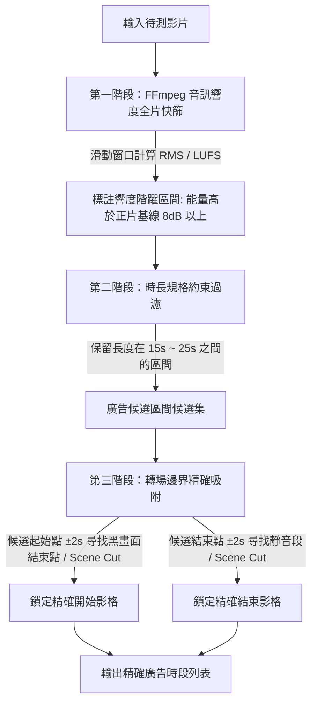

# 動畫型廣告偵測解決方案：成因分析與跨模態管線設計

## 1. 背景與問題成因

### 1.1 現有廣告偵測機制的局限
專案目前的廣告偵測核心採用三階段視覺比對架構（`Stage1Scan` 粗篩 $\rightarrow$ `Stage2Pair` 配對 $\rightarrow$ `Stage3Refiner` 微調）：
* **設計前提**：傳統電視/網路錄製影片的廣告多為 **25 秒固定圖卡**（靜止畫面、僅有局部跑馬燈或細微字幕變更）。
* **判定原理**：透過前後影格或固定模板的高結構相似度（SSIM > 0.85）與畫面低動態特性進行聚類與邊界收斂。

### 1.2 新型態動畫廣告的失效原因
在最新影片樣本（如 `S03-01.mp4`）中，廣告形式轉變為 **17～20 秒左右的商業動畫短片**：
1. **畫面動態極高**：動畫中包含豐富的角色動作、快速分鏡（Shot Cuts）與特效變換，相鄰影格或前後時間點的 SSIM 極低，原本的靜態圖卡聚類邏輯無法將其識別為廣告。
2. **跨區間非同源內容**：同一影片中出現的廣告區間（如區間 1 與區間 2）是由不同廠商贊助的**兩支完全不同的獨立動畫**，無法透過跨時間點的「重複圖卡模板」進行交叉比對。
3. **後果**：現有視覺管線將動畫視為正片內容直接略過，造成廣告區段漏抓。

---

## 2. 特徵探測過程與數據實證（基於 FFmpeg 數值分析）

為避免二進位圖片讀取風險，本分析全程使用 **FFmpeg 終端數值量測**，針對 `S03-01.mp4` 已知的兩個廣告區間進行深度探測：
* **已知區間 1**：`00:05:56.235` ～ `00:06:15.894`（影格 8541～9130，時長 19.66 秒）
* **已知區間 2**：`00:28:16.501` ～ `00:28:33.866`（影格 40793～41227，時長 17.36 秒）

### 特徵一：音訊響度暴增（Loudness Jump — 最決定性的特徵）
商業動畫廣告為了在短時間內抓住觀眾注意力，音訊會經過極端的動態範圍壓縮（Loudness War，響度飽和）。

透過 FFmpeg `volumedetect` 與 `ebur128` 濾鏡量測正片與廣告的音量數據：

| 影片區段 | 時間點 / 區間 | 平均音量 (Mean Volume) | 瞬時響度 (LUFS) | 峰值音量 (Max Volume) |
| :--- | :--- | :---: | :---: | :---: |
| **正片前段** | `00:05:00 ~ 00:05:20` | **-29.9 dB** | -30.5 LUFS | -8.9 dB |
| **廣告區間 1** | `00:05:56.235 ~ 00:06:15.894` | **-16.7 dB** (暴增 +13.2 dB) | **-12.7 ~ -17.4 LUFS** | **-1.1 dB** (近乎滿格) |
| **正片中段** | `00:27:50 ~ 00:28:10` | **-30.2 dB** | -30.8 LUFS | -11.7 dB |
| **廣告區間 2** | `00:28:16.501 ~ 00:28:33.866` | **-17.8 dB** (暴增 +12.4 dB) | **-13.0 ~ -17.5 LUFS** | **-3.9 dB** |
| **正片後段** | `00:28:40 ~ 00:29:00` | **-32.2 dB** | -31.8 LUFS | -13.4 dB |

> **結論**：
> 雖然畫面完全不同，但兩支動畫廣告的平均音量均高度一致落在 **-16.7 dB ～ -17.8 dB**，比正片整體高出整整 **12～13 dB**（物理能量高出十倍以上，主觀感受音量翻倍）。

---

### 特徵二：轉場邊界特徵（Scene Cuts & Black Frame & Silence）
廣告插入與結束返回正片時，電視台或後製流程必然存在分鏡切換、黑畫面過渡或音訊靜音緩衝。

透過 FFmpeg 邊界掃描實測：

```text
# 區間 1 進入點 (00:05:56 附近)：
[Parsed_blackdetect_0] black_start:4.833 black_end:6.168 black_duration:1.334s (對應 00:05:54.833 ~ 00:05:56.168，長達 1.33 秒純黑)
[Parsed_silencedetect_0] silence_start:6.195 silence_end:6.316 (0.12 秒過渡靜音)
-> 緊接著 00:05:56.235 動畫廣告第一格切入

# 區間 1 離開點 (00:06:15.894)：
[Parsed_silencedetect_0] silence_start:5.777 silence_end:5.860 (0.08 秒靜音)
[Parsed_metadata] pts_time:1.893578 lavfi.scene_score=0.942127 (精確落在 00:06:15.894，強烈鏡頭切換)

# 區間 2 進入點 (00:28:16.501)：
[Parsed_silencedetect_0] silence_start:6.212 silence_end:6.482 (0.27 秒靜音過渡)
[Parsed_metadata] pts_time:6.501111 lavfi.scene_score=1.000000 (精確落在 00:28:16.501，滿分硬切)

# 區間 2 離開點 (00:28:33.866)：
[Parsed_silencedetect_0] silence_start:3.220 silence_end:4.222 duration:1.002s (長達 1.0 秒靜音過渡)
[Parsed_metadata] pts_time:3.866222 lavfi.scene_score=0.871424 (精確落在 00:28:33.866，強烈鏡頭切換)
```

---

### 特徵三：時長規格約束（Duration Consistency）
* 商業廣告時段通常具有標準採購長度規格（15 秒、20 秒、30 秒）。
* 實測樣本：
  * 區間 1：`19.66 秒`（標準 20 秒廣告，扣除前後微小切換誤差）
  * 區間 2：`17.36 秒`（約 17.5 秒）
* 候選廣告長度區間可安全約束在 **15.0 秒 ～ 25.0 秒** 之間。

---

## 3. 跨模態音視偵測流程設計（Detection Process）

結合上述實證特徵，提出全新的 **音視融合偵測演算法（Audio-Visual Boundary Fusion Pipeline）**：



### 詳細執行步驟：
1. **音訊響度基線與階躍計算（Audio Loudness Step Detection）**：
   * 透過 FFmpeg `astats` 或 `ebur128`，以 0.5 秒或 1.0 秒為單位提取整支影片的音量序列。
   * 計算全片中位數音量作為正片基準線（例如 $-30\text{ dB}$）。
   * 標註出平均音量持續高於基準線 $+8\text{ dB}$（即大於 $-22\text{ dB}$）的連續時段。
2. **時長窗格過濾（Window Duration Filtering）**：
   * 排除短暫槍砲聲、爆炸或突發大聲的短片段（$< 12\text{ 秒}$）。
   * 排除長篇配樂或片頭片尾曲（$> 30\text{ 秒}$）。
   * 僅保留符合商業廣告長度（$15\text{s} \le \text{Duration} \le 25\text{s}$）的高能時段。
3. **邊界精確吸附（Boundary Snapping）**：
   * 在候選起點周圍 2 秒內，利用 `blackdetect` 與 `select='gt(scene,0.8)'` 找到離高能區間最近的「黑畫面交界」或「強分鏡切換點」，修正為廣告開始幀。
   * 在候選終點周圍 2 秒內，尋找「靜音區間（silencedetect）」或「強分鏡切換點」，修正為廣告結束幀。

---

## 4. 系統架構修改建議

### 4.1 模組化設計（不影響既有靜態管線）
在 `src/video_ad_remover/core/detector/` 下新增獨立模組：
```text
src/video_ad_remover/core/detector/
├── __init__.py
├── pipeline.py                 # 總協調器（加入策略模式）
├── stage1_scan.py              # 原靜態掃描
├── stage2_pair.py              # 原靜態配對
├── stage3_refiner.py           # 原精確微調
└── stage_audio_visual.py       # [新增] 動畫型廣告跨模態偵測器
```

### 4.2 偵測模式支援（GUI / CLI 參數）
在 `pipeline.py` 與 GUI 介面提供「偵測策略模式」選項：
1. **靜態圖卡模式 (`static_card`)**：沿用現有 Stage 1~3（針對 25 秒固定圖卡，最省資源）。
2. **動畫廣告模式 (`animation_ad`)**：啟用音視融合偵測器（針對 17~20 秒動態商業廣告）。
3. **自適應混合模式 (`hybrid`)**：
   * 先跑音視偵測（FFmpeg 音訊快篩速度極快，全片 40 分鐘約僅需 5～8 秒）。
   * 若找到高信心度的高能區間，直接納入；其餘未覆蓋時段若有需要再由視覺靜態管線補強。

---

## 5. 實作計畫與階段里程碑

### Phase 1：輕量驗證腳本開發（Prototype Verification）
* 撰寫獨立測試腳本 `scripts/test_audio_visual_detector.py`。
* 在 `S03-01.mp4` 上驗證演算法輸出是否能自動、精確還原給定的兩段廣告（誤差控制在 $\pm 2$ 影格以內）。
* 交叉測試 `S03-02.mp4`、`S03-03.mp4`，驗證跨集數通用性與門檻穩定度。

### Phase 2：核心檢測器實作（Core Implementation）
* 建立 `AudioVisualDetector` 類別，封裝 FFmpeg 音訊解析、階躍窗口偵測與分鏡吸附演算法。
* 輸出標準化 `AdInterval` 物件，與現有 `exporter.py` 無縫對接。

### Phase 3：介面與多管線整合（GUI & Pipeline Integration）
* 將新偵測器註冊至 `pipeline.py`。
* 於 GUI 介面增加動畫偵測選項或自動混合排程。
* 進行整體去廣告與影片導出驗收。
